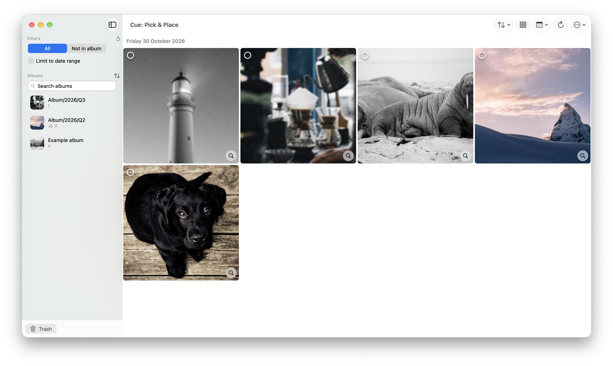
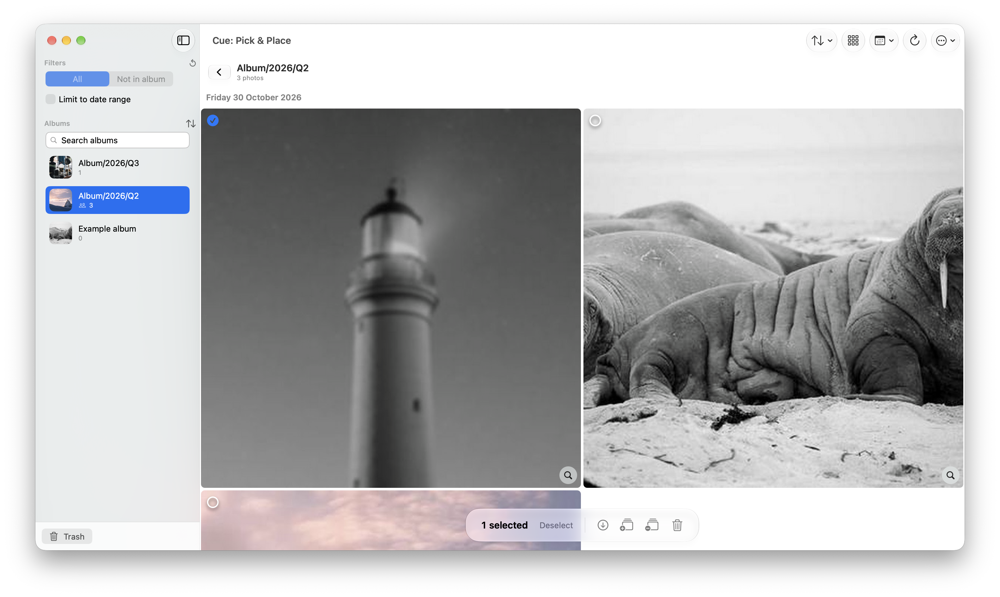
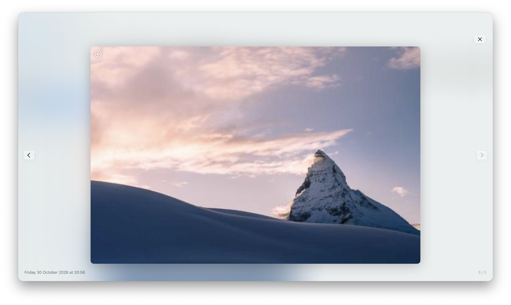

# Cue: Pick & Place (for Google Photos)

"Cue: Pick & Place", short "Cue Photos", is a native macOS app for working with your own Google
Photos library the way Google's web app won't let you: sort a backlog of photos into albums from
a fast visual grid, and pick photos across many albums to download in one go for photo books and
other projects.

## Why it exists

Since Google locked the official Photos APIs down in 2025 (apps can only see content they
created themselves), there is no official way left to organize or bulk-download your own
library. The only honest route is the same internal web API the photos.google.com page itself
uses. Cue Photos embeds a hidden web view in which you sign in to Google yourself — your
session, your data, your Mac — and drives that API with a native, fast interface on top. The
API layer is vendored from the excellent MIT-licensed
[Google Photos Toolkit](https://github.com/xob0t/Google-Photos-Toolkit).

Plainly: the app clicks through the official Google Photos web for you. Nothing is scraped from
the page, no credentials are stored by the app (the system web view holds the session, like
Safari would), and nothing ever leaves the connection between your Mac and Google.

## Screenshots







## What it does

- **Browse** your whole timeline or any album, grouped by day or month, 2–12 columns, with fast
  native thumbnails — built to stay smooth at hundreds of thousands of photos. A large library fills
  in while it loads, newest photos first.
- **Find unsorted photos**: the "Not in album" filter shows exactly the photos that are in no
  album, the one view Google Photos itself refuses to offer.
- **Select across everything**: the selection follows you across albums, filters and views, and
  survives app restarts. "Select" next to a day or month heading adds every photo of that group.
  The selection only empties when a bulk action fully succeeds or you clear it (with undo).
  After a partial failure, exactly the unprocessed photos stay selected.
- **Sort into albums**: add the selection to an existing or new album, with chunked progress.
  Inside an album, the selection bar also offers "Remove from album" — it takes out only the
  selected photos that are in that album; the photos stay in your library and other albums.
- **Label albums**: keep your own list of labels — an emoji and a name — under More → "Album
  Labels…". When you create or rename an album, pick a label from the tag menu next to the name:
  its emoji becomes the first character of the album name, so Google Photos shows it too. The
  emoji buttons under the album search filter the album list by label, and the search matches
  every word you type, so "🏖 Italy" finds every album that has both. "Export…" and "Import…" carry
  the list to another Mac or over a reinstall; deleting a label leaves album names as they are.
- **Download** the selection into a folder of your choice, with original file names, a progress
  bar, sleep prevention while running and a quit guard. Photos come as full-quality originals;
  videos come from Google's download endpoint, which serves a transcoded rendition.
- **Trash and restore**, album **rename**, album **sharing** (invite people by email from the
  album's edit dialog), a fullscreen **lightbox** with keyboard control, and full
  **Czech + English** localization.

## Requirements & install

- macOS 27 or newer, Apple silicon.
- Download the notarized disk image from
  [Releases](https://github.com/jaroslav-sazma/cue-photos/releases), open it, drag Cue Photos to
  Applications, launch, and sign in to your Google account when asked.

## Honest limitations

- The internal web API is **undocumented and unsupported**. Google can change it at any time and
  parts of the app may break until they are adapted (the vendored Toolkit project has tracked
  such changes for years). Driving your own session this way is formally outside Google's terms
  of service; you use it at your own judgment, on your own data.
- Downloads use the same media endpoints the web app uses. If EXIF/GPS fidelity is critical for
  your archive, verify a few downloaded photos first; videos are transcoded by Google's
  endpoint.
- One Google account at a time; switching accounts resets the app's local state, except your
  album labels.

## Building from source

```bash
git clone --recurse-submodules https://github.com/jaroslav-sazma/cue-photos.git
cd cue-photos
xcodebuild -scheme Photos -configuration Debug -derivedDataPath build build
```

Xcode 27+ is required. The bridge bundle `Photos/Resources/WebBridge.js` is committed, so plain
Xcode builds need no Node; see `CONTRIBUTING.md` for regenerating it, updating the Toolkit
submodule, tests and the release process.

## Privacy

No telemetry, no analytics, no accounts, no servers of ours. See `PRIVACY.md` for the complete
picture of what is stored locally and what talks to whom.

## Credits & license

The internal-API layer is vendored from
[Google Photos Toolkit](https://github.com/xob0t/Google-Photos-Toolkit) (MIT, see `NOTICE`).
Cue: Pick & Place is © 2026 Jaroslav Sazma, released under GPL-3.0-or-later (see `LICENSE`).
Part of the Cue: family of apps, alongside
[Cue: Relay & Reply](https://github.com/jaroslav-sazma/cue-bridge).

This is an independent project, not affiliated with, endorsed by, or sponsored by Google.
Google Photos is a trademark of Google LLC.
